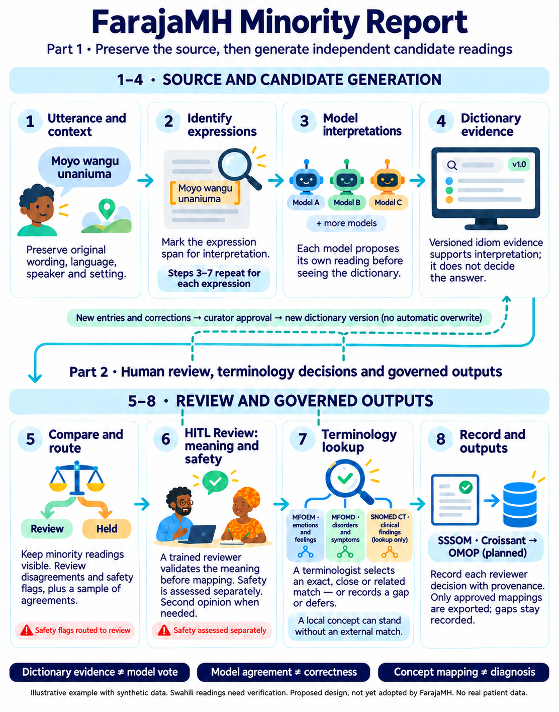

# FarajaMH Minority Report

A guided human-in-the-loop review tool for culturally grounded mental-health expressions in Kiswahili, Sheng and code-switched language. Several language models interpret each expression separately; trained reviewers decide the meaning, assess safety and sign off terminology matches.


It extends [The Minority Report](https://github.com/codata/the-minority-report) by Slava Tykhonov (CODATA). When models disagree, the less-supported reading, the *minority report*, stays visible for the reviewer instead of being discarded.



## How it works

1. **Utterance and context:** the original wording, language and setting are kept.
2. **Identify expressions:** each expression is reviewed in its full context.
3. **Model interpretations:** each model reads the expression independently, before seeing the dictionary.
4. **Dictionary evidence:** a versioned idiom library adds evidence. It is not a vote.
5. **Compare and route:** disagreements and safety flags go to review.
6. **Human review:** a reviewer approves the meaning. Safety is assessed separately.
7. **Terminology lookup:** candidates from MFOEM, MFOMD and SNOMED CT are signed off as exact, close or related matches, or recorded as gaps.
8. **Record and outputs:** every decision is versioned, with SSSOM and Croissant exports.

**Dictionary evidence ≠ model vote. Model agreement ≠ correctness. Concept mapping ≠ diagnosis.**

## Quick start

Requires Python 3.11 or later (tested on 3.13).

```sh
python3 -m venv .venv
.venv/bin/python -m pip install -r requirements.lock
.venv/bin/python -m pytest -q
```

Try it offline with built-in test responses (no models or network needed):

```sh
.venv/bin/python -m farajamh --config config.yaml init
.venv/bin/python -m farajamh --config config.yaml run examples/source.json
FARAJA_DEMO_KE_TOKEN=choose-a-long-token \
  .venv/bin/python -m farajamh --config config.yaml review --serve --port 8765
```

Open http://127.0.0.1:8765/ and sign in with the token you chose.

## Configurations

| File | Models | Terminology | Use |
|---|---|---|---|
| `config.yaml` | Built-in test responses | Fictional test concepts | Offline demo and tests |
| `config.live-test.yaml` | Local [Ollama](https://ollama.com) models | Live MFOEM, MFOMD, SNOMED CT (via EBI OLS) | Synthetic test runs on real models |

Data is stored in `work/` (SQLite database and exports), which is not committed.

## Repository layout

| Folder | Contents |
|---|---|
| `farajamh/` | Application code, prompts, schemas and the review screen |
| `tests/` | Automated tests |
| `tools/` | Scripts for building test data and validation |
| `pilot/`, `examples/` | Synthetic test cases |
| `docs/` | Design, workflow and setup documentation |
| `evidence/` | Results from earlier synthetic pilot runs |

## Documentation

- [Workflow](docs/WORKFLOW.md): the eight-step process in detail
- [Setup](docs/SETUP.md): models, terminology and run modes
- [Commands](docs/COMMANDS.md): every command-line option
- [Alignment](docs/ALIGNMENT.md): what is built and what is still missing

## Planned

- A switch between small (SLM) and large (LLM) model sets.
- Batch evaluation of model readings against reviewer-approved meanings, possibly with Gooey.AI.

## Licence

Not yet chosen. Please ask before reusing this work.
