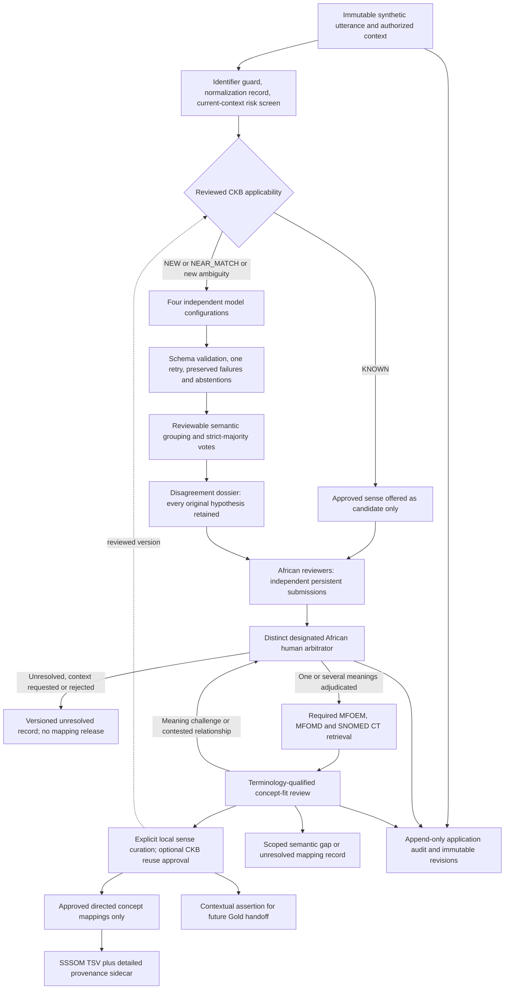

# Historical architecture, superseded as a process specification

The user-supplied v9.1 infographic takes precedence. This is the pre-alignment implementation account, retained for engineering provenance. Known-match model bypass and dictionary-fed prompts have since been removed. See [current architecture](ARCHITECTURE.md).

# Revised FarajaMH prototype

This is a new synthetic-only modular Python application. It explores the study team's Minority Report workflow; it does not claim project adoption, linguistic validation or clinical validity. The earlier checkout and adaptation are unchanged. Four decisions remain separate: a contextual interpretation, a reusable sense, a terminology relationship, and an utterance assertion.

## Modules, inputs, outputs and failures

**Input and CKB (`common.py`, `pipeline.py`, `storage.py`).** JSON Schema v1 requires `synthetic: true`, immutable original text, source/context/evidence, language hypotheses and explicit qualifiers. No text normalization is applied by default; the separate normalization record reports no edits. Email and Kenya/Tanzania telephone checks are defense in depth. An approved, current CKB sense needs exact contextual applicability, not merely text similarity. Fuzzy matches provide references only. Matching uses language, declared variety, conversation, assertion, attribution, temporal scope and setting; person references and utterance timestamps are excluded from reusable applicability. New risk/unknown qualifiers reopen generation. Failure states are invalid input, duplicate immutable utterance ID, and context mismatch. Source corrections use a new linked utterance/evidence record; decisions use new versions.

**Independent interpretation (`models.py`, versioned prompt and schemas).** Identical authorized source/prompt/evidence is delivered to each configuration sequentially. Ollama `/api/tags` verifies availability and records digests; `/api/chat` uses JSON mode. The optional OpenAI-compatible adapter requires connected mode and an environment-held key. No adapter pulls a model. Only deterministic fixtures run offline. Raw attempts, schema errors, one retry, final failure, abstention, timestamps, actual identifiers where provided and elapsed runtime persist. Schema/provenance boundaries prevent model-written approvals. No cache is used; a full candidate cache key is recorded, avoiding stale final-decision cache reuse altogether. A missing model remains a visible failed run.

**Meaning comparison (`agreement.py`).** `semantic-frame-conservative-v1` compares experience/cause/cultural-reading frames plus every contextual qualifier, category and explicit English negation markers. It never groups by translation, category or broad ontology ID alone. Normalization retains all words. Only operator-reviewed aliases are permitted; default aliases are empty. Unknown frames remain separate. Each model contributes at most one primary vote; secondary readings remain in the dossier. The threshold is `floor(V/2)+1`, with at least three eligible primary votes and at least two distinct supporters. A 2–2 split is tied; 2–1–1 has no majority. Unanimity refers only to responding eligible voters. Group signatures and evidence remain inspectable and non-authoritative. Substantive differences and risk differences are flagged for review. This conservative procedure can fragment paraphrases and can miss nuanced contradictions if models emit misleading frames; the human stage always reviews the original readings and can reject grouping conclusions.

**Persistent HITL and arbitration (`pipeline.py`, `webapp.py`, `review.html`).** SQLite stores independent submissions, exact versions and append-only audit events. The localhost UI shows source/context, attempts, all hypotheses, evidence, votes, dissent, risk and uncertainty. Identity is authenticated with environment-held tokens; roles, locality familiarity and expertise come from trusted configuration. First-time reviewers cannot see peers' submissions, including peer-risk payloads. A separate arbitrator identity requires the configured reviewer quorum and records one/multiple meanings, rejection, context request or unresolved status. CKB reuse also uses arbitration in this conservative implementation. Automatic majority is never an approved default. Stale form versions fail atomically. The UI uses editable structured decision forms and server schema checks; it is a research interface, not a patient interface.

**Terminology (`terminology.py`).** After adjudication, each accepted meaning's search terms query all three mandatory resources. MFOEM/MFOMD support pinned OLS ontology versions and local OWL indexes; OLS search hits are verified via term retrieval. RDF/XML/Turtle imports require a matching declared `owl:versionIRI`, reject external XML entities and do not fetch ontology imports. SNOMED CT uses concept, description and language-reference-set RF2 Snapshot files in a local SQLite/FTS5 index. It retains SCTIDs as strings, edition/release/module/activity, selected preferred synonym, FSN and language refset. Import is staged and published atomically. Unknown identifiers are rejected; inactive terms are visible but unapprovable. Metadata, lexical scores, queries and mismatch notes remain distinct from semantic predicates. `UNAVAILABLE`, `SEARCH_FAILED`, `NO_RESULTS`, and human-declared gaps are distinct. Missing SNOMED blocks complete terminology review/export. Fixture IDs use `FIXTURE:` and are never described as real ontology identifiers.

**Mapping, gaps and local curation (`pipeline.py`).** Terminology-qualified identities approve/reject directed relationships or retain unresolved/gap decisions. Gap claims require a successful search, rather than an unavailable resource. A challenged meaning or contested relation invalidates the current adjudication and returns to the arbitrator; after new sign-off, retrieval and mapping review are repeated. Explicit curator approval creates/versions a stable sense, including definition, cultural applicability, ownership and evidence; CKB reuse approval is a separate Boolean decision. CKB meaning records omit person/utterance-time qualifiers. No nearest-neighbor mapping is forced. Model and external scores cannot choose a predicate. Curation changes mark dependent links/mappings stale; review changes invalidate the meaning and all dependent artifacts.

**Exports, metadata, metrics (`exports.py`, `reporting.py`).** Releases contain only current approved concept-to-concept mappings, current adjudication/sense/release versions, declared CURIEs and supported SSSOM 1.0 fields. Detailed workflow evidence resides in a linked JSON sidecar. Synthetic assertions are separate, with `omop_concept_id: null`; SCTIDs are never relabeled as OMOP IDs. Demonstration exports are explicitly `SIMULATED`, blocked from real release and real-review statistics. Croissant JSON-LD uses relative resolvable artifact references and checksums; the exported package can be moved as a unit. Historical export snapshots remain immutable and corrections append `EXPORT_STALE` audit events. SQLite triggers provide application-level append-only protection, not cryptographic tamper-proofing or defense against a database administrator.

## Figure alignment and evidence boundaries

The local architecture image read was `../farajaMH-minority-report/farajamh-cultural-interpretation-pipeline/architecture/FarajaMH_MinorityReport_Architecture_v1.png`. The local workflow image read was `../farajaMH-minority-report/images/farajamh-interpretation-workflow.png`; its SVG companion and `DESIGN.md` supply earlier engineering context. Both show preserved source, independent candidate readings, disagreement, human review, local concepts and governed mappings. The earlier workflow explicitly says no arbitration selects a reading and marks SNOMED pending. Those details are superseded here: a distinct human arbitrator is mandatory and SNOMED is enabled and required; retrieval follows meaning adjudication.

The exact original WP2 image and the infographic titled “When Translation Models Split on the Meaning of Idioms of Distress” were not found in the supplied attachment or relevant local project files. Their claimed visual contents have not been verified. The revised prompt's explicitly transcribed pathway is implemented. No WP3/acoustic processing, training, full OMOP ETL or clinical recommendations are included.

## Verified upstream engineering evidence

Actual upstream commit: `a7cb9cbf90cffb186c69699b5a188f970d22e5b9` at `../the-minority-report`. The technical review read was the earlier adaptation's `DESIGN.md`; its assertions were checked against code. No applicable `AGENTS.md` was found in the relevant project directories. There is no wholesale vendoring of upstream or its README, which includes unrelated sensitive configuration.

| Component | Verified source/function/lines at pinned commit | Treatment |
|---|---|---|
| Streaming file hashing | `translation-skill/scripts/croissant_generator.py:22`, `compute_sha256` (22–31) | Reused small streaming SHA-256 pattern in `common.file_hash`, corrected to fail on unreadable artifacts instead of returning an invalid checksum string. |
| Model routing and prompt files | `orchestrator.py:57`, `ModelRouter`; `:99`, `mock_llm_call`; `:195`, `load_prompt` | Reused engineering patterns, newly implemented allowlisted gateway and sequential independent adapter calls. No upstream server defaults carried over. |
| JSON repair | `orchestrator.py:181`, `repair_json`; tests at `translation-skill/tests/test_orchestrator.py:58` | Replaced heuristic quote repair with strict schema validation and a preserved single retry. Upstream tests demonstrate the trailing-quote case but not schema safety. |
| String voting | `orchestrator.py:824–842`, `process_terms` | Replaced lowercased-string counting and `count >= 2` with contextual signatures and strict majority plus participation. |
| AI arbitration | `orchestrator.py:447`, `_arbitrate_model`; `:850–894`, arbitration branch | Replaced by authenticated human arbitration. The old branch can select a synthesized winner not present in original rows: `found_match` is set but never used to append it. Losers are only labeled. |
| Policy | `api.py:88–124`, `_validate_odrl_policy` | Replaced. Missing policy returns without validation (96–97); enforcement focuses on environment variables and catches policy errors. No comprehensive FarajaMH permissions/state enforcement exists there. |
| Provenance/catalog | `orchestrator.py:1122–1132`; `api.py:352–395`; `croissant_generator.py:13–19,548` | Replaced winner-filtered metadata with all-output dossiers and sidecars. Removed machine-specific import path; added actual model digest where available, input/prompt/config/code hashes and versioned decisions. |
| Human governance, CKB, RF2, SSSOM | Verified against upstream Python paths and earlier adaptation | New modules, not claims about existing upstream capability. Earlier adaptation `agreement.py:127` can label support at its configurable threshold as majority; no direct reuse of that decision logic. |

The reuse boundary is deliberately narrow: utility and orchestration patterns transfer; the tested upstream translation decision behavior conflicts with this request. New regression tests exercise the replacement behavior rather than importing the large upstream service and its configuration.

Demonstration SSSOM rows use `semapv:UnspecifiedMatching` because there was no actual human curation. `semapv:ManualMappingCuration` is reserved for actual human-curated research releases; detailed simulated decisions remain explicit in the sidecar.
