# Architecture and implementation boundary

The [v9.1 infographic](figures/Minority_Report_FarajaMH_workflow_v9_1.png) defines the revised process. This proposal has not been adopted by FarajaMH and has been tested on dummy data only. The diagram below describes the target process, not completed software.

```mermaid
flowchart LR
    A[1 · Utterance and context] --> B[2 · Identify expressions]
    B --> C[3 · Independent model interpretations]
    C --> D[4 · Dictionary evidence]
    D --> E[5 · Compare and route]
    E -->|Selected for review| F[6 · HITL Review of meaning]
    F -->|Approved meaning| G[7 · Terminology lookup and sign-off]
    G --> H[8 · Record and outputs]
```

Steps 3–7 repeat for each expression. Models receive no dictionary evidence in their first interpretation calls. Step 5 retains other agreed cases as unreviewed, with no approved mapping or export. Step 6 keeps safety assessment separate and requests context for unresolved meaning. Step 7 can record a gap or defer; neither state is an approved external mapping.

New-entry and correction proposals from reviewers in steps 6–7 require curator approval before a new dictionary version. This is the feedback process shown in the infographic, not an extra review stage.

## Current code

`pipeline.App.run` now calls `models.interpret` before the existing local-sense lookup. `models.interpret` accepts only configuration and source, not retrieved library entries. Known local senses remain review evidence and never bypass model calls. Prompt/input hashes and empty first-pass reference-version lists remain in model provenance.

Other runtime modules still implement the earlier architecture. [ALIGNMENT.md](ALIGNMENT.md) lists the important gaps, and [WORKFLOW.md](WORKFLOW.md) records the target requirements. [ARCHITECTURE-legacy.md](ARCHITECTURE-legacy.md) preserves the earlier module descriptions and upstream engineering evidence as history, not as an authority for the new process.

The older mandatory reviewer quorum and distinct arbitrator, knowledge-base bypass policy, mandatory terminology-resource gates, fixed configuration counts and extra export formats must not be read into the infographic. Existing support for a tool or artifact does not make it a required new-process stage.
